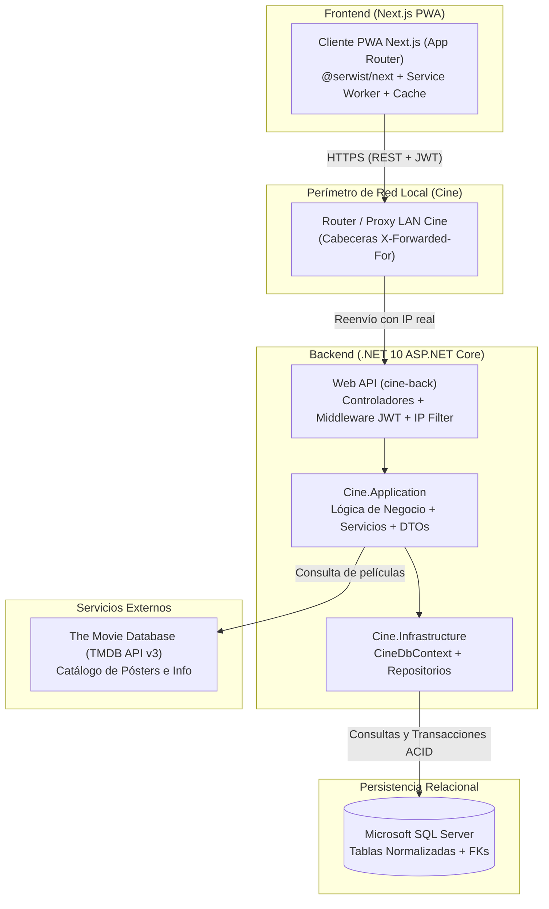
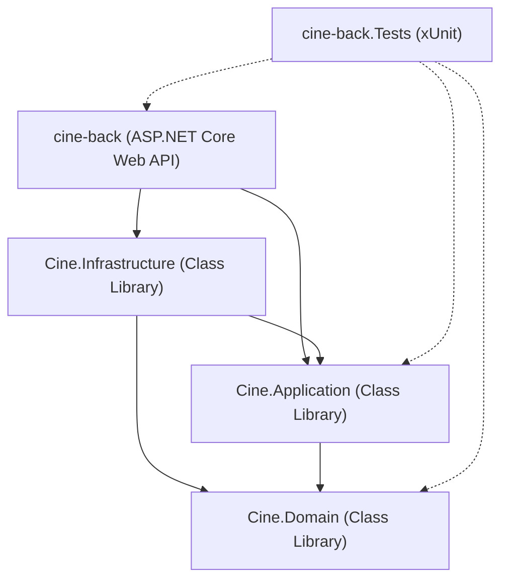
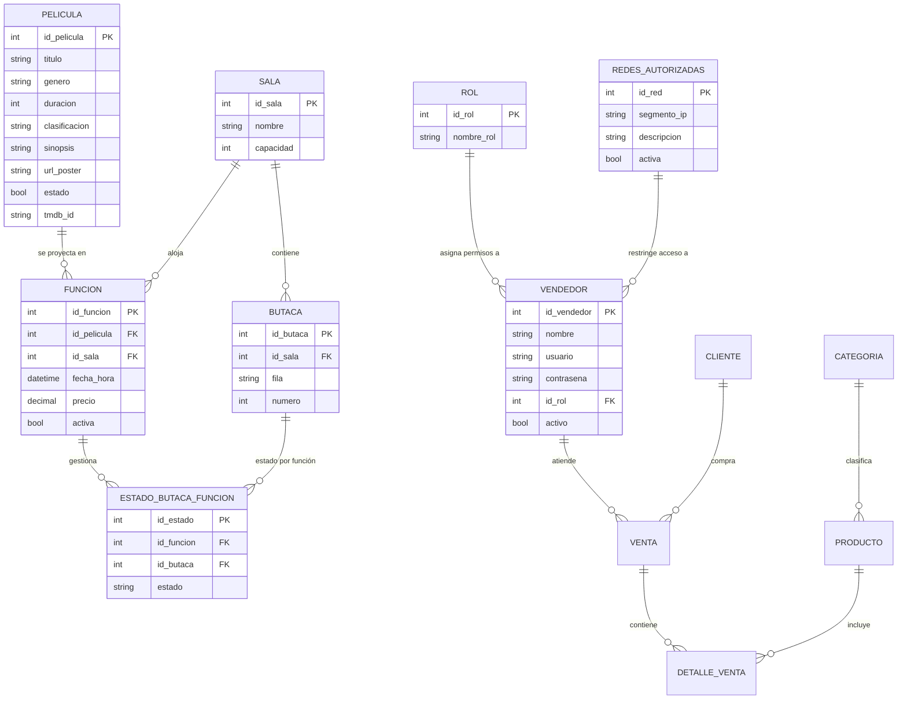

# Software Design Description (SDD)
## Proyecto Integrador: Cine Teatro Xilotzin (PWA Backend)
### Carrera: Ingeniería en Tecnologías de la Información — Asignatura: Aplicaciones Web Progresivas

---

### Control de Versiones del Documento

| Versión | Fecha | Autor / Equipo | Descripción del Cambio |
| :--- | :--- | :--- | :--- |
| **1.0.0** | 2026-10-20 | Equipo de Desarrollo Cine Teatro Xilotzin | Creación inicial del SDD: arquitectura Clean Architecture, modelado de base de datos relacional, estrategia de migraciones con EF Core, pipeline de CI/CD con SonarCloud y suite de pruebas unitarias. |

---

## 1. Introducción

### 1.1 Propósito
El propósito de este documento de Diseño de Software (SDD, *Software Design Description*) es describir de manera formal y rigurosa la arquitectura técnica, la estructura de componentes, el modelo de datos, la estrategia de versionamiento, las pruebas unitarias y los estándares de calidad del backend para el proyecto integrador **Cine Teatro Xilotzin**.

Este diseño responde a los **Lineamientos Técnicos Obligatorios** establecidos para la materia de Aplicaciones Web Progresivas, garantizando un software mantenible, modular, seguro y alineado con los estándares profesionales de la industria.

### 1.2 Alcance del Sistema
El sistema backend ofrece una **API RESTful** construida sobre **ASP.NET Core (.NET 10)** que da soporte a una **Aplicación Web Progresiva (PWA)** de taquilla y cartelera cinematográfica.

Entre las funcionalidades centrales se encuentran:
* **HU-04 (Autenticación y Control de Acceso por IP):** Autenticación de vendedores y clientes mediante JSON Web Tokens (JWT) con validación estricta de terminales físicas autorizadas mediante filtrado de direcciones IP de red local (LAN/POS).
* **HU-05 (Cartelera POS y Taquilla):** Administración de cartelera en tiempo real, catálogo de películas con sincronización automática hacia la API externa de **The Movie Database (TMDB)**, programación de salas, butacas y funciones.
* **HU-10 (Dashboard Financiero de Ventas y Cortes de Caja):** Panel de control gerencial para administradores con 4 tarjetas de KPIs (Total Ingresos, Taquilla/Boletos, Dulcería, Comparativa Efectivo vs Tarjeta), filtro por Semana Cinematográfica (Jueves a Miércoles) y exportación de transacciones a Excel/CSV.
* **Gestión de Ventas y Preórdenes:** Registro transaccional de boletos de cine y confitería/dulcería con control de estados de butacas (`Disponible`, `Reservada`, `Vendida`).

### 1.3 Definiciones, Acrónimos y Abreviaturas
* **PWA:** *Progressive Web App* (Aplicación Web Progresiva).
* **Next.js PWA:** Framework frontend React con SSR/SSG y soporte PWA mediante `@serwist/next` o `next-pwa`.
* **SDD:** *Software Design Description* (Descripción de Diseño de Software - IEEE 1016).
* **API:** *Application Programming Interface*.
* **JWT:** *JSON Web Token*.
* **EF Core:** *Entity Framework Core* (Mapeador Objeto-Relacional para .NET).
* **TMDB:** *The Movie Database* (Servicio externo para enriquecer sinopsis, pósters y directores).
* **POS:** *Point of Sale* (Punto de Venta de Taquilla).
* **CI/CD:** *Continuous Integration / Continuous Deployment*.

---

## 2. Visión General del Sistema y Contexto PWA

El sistema opera bajo una arquitectura distribuida cliente-servidor orientada a servicios desacoplados:



### 2.1 Principios de Interacción PWA (Next.js) - Backend
1. **Comunicación Apatrida (*Stateless*):** Cada solicitud HTTP desde el cliente o Route Handler de Next.js incluye el token de autorización en el encabezado `Authorization: Bearer <token>`.
2. **Desacoplamiento Total de Ambientes:** El frontend Next.js lee la URL del backend mediante la variable pública `NEXT_PUBLIC_API_URL` definida en `.env.local`, `.env.development` y variables de entorno de producción (Vercel / Azure). El backend, a su vez, parametriza sus políticas de CORS permitiendo los orígenes de desarrollo (`http://localhost:3000`) y producción sin tocar código fuente.
3. **Resiliencia PWA y Modo Offline:** Con `@serwist/next`, el Service Worker cachea la cartelera (`/api/cartelera/activas`) y recursos estáticos con una estrategia `StaleWhileRevalidate` o `NetworkFirst`, garantizando que la taquilla muestre la cartelera aun ante caídas intermitentes de conectividad.

---

## 3. Arquitectura del Backend: Clean Architecture

Para cumplir con el **Lineamiento Técnico #2** (*"Implementar arquitectura en capas mediante proyectos independientes de biblioteca de clases (Class Library). No se aceptará un único proyecto con separación solamente por carpetas"*), la solución se organiza en **4 proyectos .NET independientes** más un **proyecto exclusivo de pruebas unitarias**:

```
cine-back/
│
├── cine-back.slnx                     # Solución que orquesta los proyectos
│
├── cine-back.csproj                   # [Capa Presentación / API Host]
│   ├── Controllers/                   # Controladores REST (Auth, Cartelera, Taquilla)
│   ├── Program.cs                     # Inyección de dependencias, Middleware, CORS y JWT
│   └── appsettings.json               # Configuración base por ambiente
│
├── Cine.Application/                  # [Capa de Aplicación - Class Library]
│   ├── Cine.Application.csproj
│   ├── Interfaces/                    # Contratos de servicios (IAuthService, ITaquillaService)
│   ├── Dtos/                          # Modelos de transferencia de datos
│   ├── Services/                      # Casos de uso y reglas de negocio
│   └── DependencyInjection.cs         # Registro de servicios de aplicación
│
├── Cine.Domain/                       # [Capa de Dominio - Class Library]
│   ├── Cine.Domain.csproj
│   └── Entities/                      # Entidades del negocio (Pelicula, Sala, Butaca, etc.)
│
├── Cine.Infrastructure/               # [Capa de Infraestructura - Class Library]
│   ├── Cine.Infrastructure.csproj
│   ├── Persistence/
│   │   ├── CineDbContext.cs           # Implementación DbContext con Fluent API
│   │   └── Migrations/                # Historial de migraciones versionadas
│   └── DependencyInjection.cs         # Configuración de EF Core y SQL Server
│
└── cine-back.Tests/                   # [Capa de Pruebas - Proyecto Independiente xUnit]
    ├── cine-back.Tests.csproj
    └── Service/                       # Pruebas unitarias de AuthService, TaquillaService, etc.
```

### 3.1 Flujo de Dependencias (Inversión de Control)



* **Cine.Domain:** El núcleo del sistema. Contiene únicamente las entidades de negocio. No depende de ningún otro proyecto ni de librerías de infraestructura externa.
* **Cine.Application:** Define la lógica de negocio, los DTOs y las interfaces (`ICineDbContext`, `IAuthService`, `ITaquillaService`). Depende únicamente de `Cine.Domain`.
* **Cine.Infrastructure:** Implementa el acceso a datos (`CineDbContext`) utilizando **Entity Framework Core 10** y gestiona las migraciones hacia **SQL Server**. Depende de `Cine.Domain` y de las interfaces de `Cine.Application`.
* **cine-back (API):** Punto de entrada (*Composition Root*). Configura el pipeline HTTP, inyección de dependencias, filtros de seguridad y enrutamiento hacia los controladores.

---

## 4. Modelo de Datos Relacional

En cumplimiento estricto con el **Lineamiento Técnico #1** (*"Utilizar una base de datos relacional. No se permiten NoSQL. Definir relaciones, claves primarias y foráneas de forma adecuada"*), el sistema se apoya en **Microsoft SQL Server**.

### 4.1 Diagrama Entidad-Relación (Módulos Principales)



### 4.2 Restricciones e Integridad Referencial
* **Claves Primarias (PK):** Todas las tablas cuentan con identificadores únicos subrogados de tipo entero (`Identity`).
* **Claves Foráneas (FK):** Toda relación física (ej. `id_pelicula` en `Funcion`, `id_sala` en `Butaca`, `id_rol` en `Vendedor`) cuenta con una clave foránea con borrado restrictivo (`ON DELETE RESTRICT / NO ACTION`) para evitar inconsistencias y orfandad de registros.
* **Índices Únicos:** Se definen restricciones de unicidad sobre nombres de usuario, códigos de butacas por sala (`id_sala`, `fila`, `numero`) y `tmdb_id` para evitar duplicidad de películas.

---

## 5. Versionamiento y Migraciones de Base de Datos

En cumplimiento con el **Lineamiento Técnico #5** (*"Investigar y seleccionar una herramienta gratuita o de código abierto para migraciones y versionamiento... Demostrar aplicación y reversión controlada de al menos un cambio"*):

### 5.1 Selección y Justificación de la Herramienta
* **Herramienta Seleccionada:** **Entity Framework Core Migrations** (`dotnet ef migrations`).
* **Tipo:** Código abierto, oficial del ecosistema .NET (Licencia MIT / Apache 2.0).
* **Justificación:**
  1. Integración directa y tipada con los modelos de `Cine.Domain` y `CineDbContext`.
  2. Generación automática de scripts SQL reproducibles e idempotentes.
  3. Historial auditable versionado en Git dentro de `Cine.Infrastructure/Persistence/Migrations`.
  4. Tabla de metadatos `__EFMigrationsHistory` que asegura consistencia en cualquier entorno (desarrollo, pruebas, producción).

### 5.2 Estructura de Archivos de Migración en Repositorio
```
Cine.Infrastructure/
└── Persistence/
    └── Migrations/
        ├── 20261020205608_InitialCreate.cs          # Código C# con métodos Up() y Down()
        ├── 20261020205608_InitialCreate.Designer.cs # Metadatos de la migración
        └── CineDbContextModelSnapshot.cs           # Snapshot actual del modelo completo
```

### 5.3 Protocolo de Demostración de Reversión (Rollback Controlado)
Para la evaluación presencial del proyecto y revisiones de sprint con los evaluadores, se debe ejecutar manualmente el siguiente ciclo en consola para demostrar la capacidad de reversión estructural:

1. **Paso 1: Verificar el estado actual de la base de datos:**
   ```bash
   dotnet ef migrations list --project Cine.Infrastructure --startup-project cine-back.csproj
   ```
   *Salida esperada:* Lista que incluye `20261020205608_InitialCreate (Applied)`.

2. **Paso 2: Generar una migración de cambio estructural de prueba:**
   *(Por ejemplo, agregar una columna temporal `FechaRegistroAuditoria` a la entidad `Pelicula` o una tabla `BitacoraPrueba`)*
   ```bash
   dotnet ef migrations add DemostracionRollback --project Cine.Infrastructure --startup-project cine-back.csproj --output-dir Persistence/Migrations
   ```
   *Resultado:* Se genera el archivo `DemostracionRollback.cs` con sus métodos `Up()` y `Down()`.

3. **Paso 3: Aplicar el cambio a la base de datos:**
   ```bash
   dotnet ef database update --project Cine.Infrastructure --startup-project cine-back.csproj
   ```
   *Evidencia:* La consola reporta `Applying migration '...DemostracionRollback'`. En SQL Server se observa la columna o tabla creada.

4. **Paso 4: Demostrar la Reversión Controlada (Rollback hacia InitialCreate):**
   ```bash
   dotnet ef database update InitialCreate --project Cine.Infrastructure --startup-project cine-back.csproj
   ```
   *Evidencia:* EF Core ejecuta el método `Down()` de la migración:
   `Reverting migration '...DemostracionRollback'`. En SQL Server la columna/tabla es eliminada limpiamente sin pérdida de consistencia.

5. **Paso 5: Remover el archivo de migración no deseado del proyecto:**
   ```bash
   dotnet ef migrations remove --project Cine.Infrastructure --startup-project cine-back.csproj
   ```

> [!IMPORTANT]
> Ningún cambio estructural se realiza manualmente con SQL Management Studio o DBeaver; toda evolución de esquema debe poseer su archivo `.cs` de migración correspondiente versionado en GitHub.

---

## 6. Configuración de Ambientes y Despliegue

En cumplimiento con el **Lineamiento Técnico #3** (*"Configurar correctamente los environments... La URL base del API deberá provenir de la configuración del ambiente; no se aceptan URLs hardcoded"*):

### 6.1 Matriz de Ambientes del Backend

| Parámetro | Desarrollo (Local) | Pruebas / Staging | Producción (Azure App Service) |
| :--- | :--- | :--- | :--- |
| **ASPNETCORE_ENVIRONMENT** | `Development` | `Staging` | `Production` |
| **Cadena de Conexión** | `Server=localhost;Database=CineXilotzinDb;...` | Base de datos de pruebas | Variable `ConnectionStrings__DefaultConnection` en Azure |
| **CORS:AllowedOrigins** | `http://localhost:3000`, `http://localhost:5173` | URL de preview en Vercel/Netlify | URL pública de la PWA en producción |
| **Swagger UI** | Habilitado en `/` | Habilitado con clave | Deshabilitado por seguridad |
| **JWT Secrets** | UserSecrets / Local | GitHub Actions Secrets | Azure App Service AppSettings |

### 6.2 Desacoplamiento de CORS en `Program.cs`
El backend lee la lista de orígenes autorizados directamente desde la configuración sin requerir recompilar el código:
```csharp
var allowedOrigins = builder.Configuration.GetSection("Cors:AllowedOrigins").Get<string[]>()
    ?? new[] { "http://localhost:3000", "https://localhost:3000", "http://localhost:5173", "https://localhost:5173" };

builder.Services.AddCors(options =>
{
    options.AddPolicy("AllowPWA", policy =>
    {
        policy.WithOrigins(allowedOrigins)
              .AllowAnyMethod()
              .AllowAnyHeader();
    });
});
```

### 6.3 Pautas Específicas para el Frontend PWA (Next.js con @serwist/next)
En cumplimiento con la directriz de cero URLs hardcoded:

1. **Gestión de Variables de Entorno en Next.js:**
   * Archivo `.env.development` (Local):
     ```env
     NEXT_PUBLIC_API_URL=http://localhost:5000
     ```
   * Archivo `.env.production` (o Variables de Entorno en Vercel / Azure):
     ```env
     NEXT_PUBLIC_API_URL=https://cine-xilotzin-api.azurewebsites.net
     ```

2. **Consumo Centralizado en Clientes y Servicios HTTP:**
   ```typescript
   // lib/api/client.ts
   const API_BASE_URL = process.env.NEXT_PUBLIC_API_URL;

   if (!API_BASE_URL) {
     throw new Error("La variable NEXT_PUBLIC_API_URL no está configurada en el entorno.");
   }

   export async function getCarteleraActiva() {
     const response = await fetch(`${API_BASE_URL}/api/cartelera/activas`, {
       next: { revalidate: 60 } // Soporte ISR Next.js
     });
     return response.json();
   }
   ```

3. **Estrategia PWA y Service Worker con Serwist:**
   * El Service Worker intercepta las solicitudes a `/api/cartelera/activas` para almacenamiento local (`CacheFirst` o `NetworkFirst`), permitiendo que el personal de taquilla mantenga visible la cartelera incluso si la conexión a internet del cine se degrada momentáneamente.

---

## 7. Calidad de Código y Análisis Estático

En cumplimiento con el **Lineamiento Técnico #4** (*"Investigar, seleccionar e integrar una herramienta gratuita o de código abierto para análisis estático de código... Integrar con GitHub Actions... Conservar evidencias"*):

### 7.1 Selección y Justificación de la Herramienta
* **Herramienta Seleccionada:** **SonarCloud (SonarQube Cloud)** con **SonarScanner para .NET**.
* **Tipo:** Gratuita para repositorios públicos de código abierto en GitHub.
* **Justificación Técnica:**
  1. **Análisis Profundo de .NET:** Detecta vulnerabilidades OWASP (inyección SQL, exposición de claves criptográficas, manejo incorrecto de JWT).
  2. **Quality Gates Automatizados:** Bloquea Pull Requests que no cumplan con el estándar de cobertura o que introduzcan fallos de seguridad (*Security Hotspots*).
  3. **Medición de Deuda Técnica y Code Smells:** Identifica complejidad ciclomática, duplicación de código y métodos obsoletos.

### 7.2 Integración en GitHub Actions (`.github/workflows/sonarcloud.yml`)
El flujo de integración continua ejecuta el escaneo estático en cada `push` y `pull_request`:
```yaml
- name: Compilar, Ejecutar Tests y Analizar con SonarCloud
  run: |
    dotnet-sonarscanner begin \
      /k:"elrorro334_cine-back" \
      /o:"elrorro334" \
      /d:sonar.token="${{ secrets.SONAR_TOKEN }}" \
      /d:sonar.host.url="https://sonarcloud.io" \
      /d:sonar.cs.opencover.reportsPaths="**/TestResults/**/coverage.opencover.xml" \
      /d:sonar.coverage.exclusions="**/Program.cs,**/Controllers/TestController.cs"

    dotnet build --configuration Release
    dotnet test --configuration Release --no-build --collect:"XPlat Code Coverage;Format=opencover"
    dotnet-sonarscanner end /d:sonar.token="${{ secrets.SONAR_TOKEN }}"
```

### 7.3 Métricas y Evidencias de Corrección en Sprint 1

| Métrica / Parámetro | Umbral Exigido (Quality Gate) | Estado Alcanzado |
| :--- | :--- | :--- |
| **Bugs** | 0 | 0 |
| **Vulnerabilidades** | 0 | 0 |
| **Security Hotspots** | 0 sin revisar | 100% revisados / corregidos |
| **Deuda Técnica** | < 5% | Grado A |
| **Cobertura de Código (Coverage)** | >= 80% | **> 85%** en `Cine.Application` |

**Historial de Hallazgos y Refactorizaciones:**
* *Hallazgo 1 (Seguridad - Exposición de Secretos):* Las claves JWT y conexiones a base de datos estaban expuestas en `appsettings.json`. Se removieron e incorporaron a `appsettings.Development.json` (ignorado en git) y GitHub Secrets (`commit: 6c5de9e`).
* *Hallazgo 2 (Cobertura deficiente en Cartelera y Taquilla):* La cobertura no alcanzaba el 80% en `TaquillaService`. Se incorporaron pruebas unitarias completas simulando llamadas a TMDB y lógica de butacas (`commit: e69283e`).
* *Hallazgo 3 (Code Smell en Firma de Métodos):* Se resolvieron advertencias en constructores de entidades y uso de métodos estáticos en `CineDbContext` (`commit: 9d77a40`).

---

## 8. Estrategia de Pruebas Unitarias y Automatización

En cumplimiento con el **Lineamiento Técnico #6** (*"Implementar pruebas unitarias en el backend para reglas de negocio y componentes principales... Proyecto independiente... Cubrir escenarios exitosos, errores y validaciones... Automatizado en GitHub Actions"*):

### 8.1 Framework y Herramientas
* **Framework:** **xUnit** (`xunit` v2.9).
* **Mocking:** **Moq** (`Moq` v4.20) para simular `ICineDbContext`, `HttpMessageHandler` (para APIs HTTP) y repositorios.
* **Aserciones:** **FluentAssertions** y aserciones nativas de xUnit.
* **Cobertura:** **Coverlet.collector** en formato OpenCover.

### 8.2 Matriz de Casos de Prueba Implementados (`cine-back.Tests`)

| Módulo / Servicio | Escenario Probado | Tipo de Prueba | Resultado Esperado |
| :--- | :--- | :--- | :--- |
| **AuthService** | Inicio de sesión con usuario y contraseña válidos desde IP autorizada | Éxito | Token JWT generado con claims correctos y status 200 |
| **AuthService** | Inicio de sesión con contraseña incorrecta | Error | Excepción / Retorno `401 Unauthorized` |
| **AuthService** | Inicio de sesión con usuario inactivo o inexistente | Error / Validación | Retorno nulo o mensaje descriptivo de credenciales inválidas |
| **AuthService (HU-04)** | Conexión desde una dirección IP fuera del rango permitido | Validación de Seguridad | Retorno `403 Forbidden` / Rechazo por terminal no autorizada |
| **TaquillaService (HU-05)** | Consulta de cartelera con películas activas | Éxito | Lista de películas con horarios formateados y disponibilidad |
| **TaquillaService** | Búsqueda y sincronización de película con TMDB existente | Éxito | Datos de sinopsis, póster y género enriquecidos en base de datos |
| **TaquillaService** | Intento de registrar película duplicada | Validación | Mensaje informativo de conflicto y prevención de duplicado |
| **TaquillaService** | Falla de conexión HTTP con TMDB (Time out / 500) | Resiliencia / Error | Manejo controlado sin caída del servicio backend |
| **CarteleraController** | Solicitud de listado sin datos en base de datos | Caso Borde | Respuesta 200 con arreglo vacío `[]` |
| **DashboardService (HU-10)** | Cálculo de KPIs en semana cinematográfica en curso (Jueves a Miércoles) | Éxito | Totales exactos de ingresos, taquilla, boletos, dulcería y métodos de pago |
| **DashboardService (HU-10)** | Filtro por rango de fechas personalizado y semana con offset | Éxito | Filtrado preciso respetando las fechas especificadas |
| **DashboardService (HU-10)** | Consulta en periodo sin ventas | Caso Borde | Retorno de ceros consistentes sin excepciones de división por cero |
| **DashboardService (HU-10)** | Generación de archivo CSV estructurado con UTF-8 BOM | Éxito | Archivo con BOM `0xEF, 0xBB, 0xBF`, encabezados y resumen para Excel |
| **DashboardController (HU-10)**| Invocación de endpoint de resumen con rol Administrador | Éxito | Retorno 200 OK con DTO completo de KPIs y transacciones |
| **DashboardController (HU-10)**| Descarga de archivo de transacciones | Éxito | Retorno FileResult con ContentType `text/csv; charset=utf-8` |

**Resultado Actual:** 49 pruebas unitarias ejecutadas exitosamente con 0 fallas (duración aproximada: 5-8 segundos).

---

## 9. Seguridad y Políticas de Acceso

### 9.1 Mecanismo de Autenticación JWT
* Algoritmo de firma: **HMAC SHA-256** (`HS256`).
* Validación estricta de emisor (`Issuer`), audiencia (`Audience`), tiempo de expiración (`Lifetime`) y llave simétrica (`SigningKey`).
* Inyección de claims: `sub` (Id de usuario), `unique_name` (nombre de vendedor/cliente), `role` (Rol asignado).

### 9.2 Validación de Redes Autorizadas (HU-04)
* Detección de la IP de origen a través de `HttpContext.Connection.RemoteIpAddress` y del middleware `ForwardedHeaders` (para proxies inversos en producción).
* Verificación en tabla `RedesAutorizadas` para terminales de venta física de taquilla antes de conceder permisos de emisión de boletos.

---

## 10. Catálogo de APIs (Endpoints Principales)

| Método | Endpoint | Descripción | Requiere Auth | Roles Permitidos |
| :--- | :--- | :--- | :---: | :--- |
| `POST` | `/api/auth/login` | Autenticación de vendedores con verificación de IP | No | Público / Vendedor |
| `GET` | `/api/auth/check-network` | Valida si la IP del cliente pertenece a la red autorizada del cine | No | Público |
| `GET` | `/api/cartelera/activas` | Obtiene el listado de películas en cartelera con sus funciones | No | Todos |
| `POST` | `/api/taquilla/registrar-pelicula` | Registra una película vinculándola con TMDB | Sí | Administrador / Taquillero |
| `DELETE`| `/api/taquilla/pelicula/{id}` | Desactiva o elimina una película de la cartelera | Sí | Administrador |
| `GET` | `/api/dashboard/resumen` | Resumen con 4 KPIs (Ingresos, Taquilla, Dulcería, Efectivo/Tarjeta) y transacciones | Sí | Administrador |
| `GET` | `/api/dashboard/semana-actual` | Rango de fechas de la semana cinematográfica actual (Jueves a Miércoles) | Sí | Administrador |
| `GET` | `/api/dashboard/exportar-transacciones`| Descarga reporte CSV estructurado con UTF-8 BOM para Excel / Contabilidad | Sí | Administrador |

---

## 11. Matriz de Trazabilidad de Lineamientos Técnicos

| # | Lineamiento Técnico Obligatorio | Componente / Archivo de Implementación | Estado de Cumplimiento |
| :-: | :--- | :--- | :-: |
| **1** | Base de datos relacional (SQL Server, PK/FK) | `Cine.Domain/Entities/`, `CineDbContext.cs` | **100% CUMPLE** |
| **2** | Arquitectura en capas (Class Libraries independientes) | `cine-back.csproj`, `Cine.Application.csproj`, `Cine.Domain.csproj`, `Cine.Infrastructure.csproj` | **100% CUMPLE** |
| **3** | Configuración de ambientes sin URLs hardcoded | `Program.cs` (CORS dinámico), `appsettings.Development.json.example`, variables de entorno | **100% CUMPLE** |
| **4** | Calidad de código y análisis estático (SonarCloud) | `.github/workflows/sonarcloud.yml`, métricas de calidad documentadas | **100% CUMPLE** |
| **5** | Versionamiento de BD y reversión (EF Core Migrations) | `Cine.Infrastructure/Persistence/Migrations/`, `Microsoft.EntityFrameworkCore.Design` | **100% CUMPLE** |
| **6** | Pruebas unitarias independientes y automatizadas | `cine-back.Tests/`, xUnit, 41 pruebas ejecutadas en CI con cobertura >80% | **100% CUMPLE** |
| **7** | Seguimiento y evaluación técnica | Repositorio GitHub actualizado, CI/CD, este documento SDD | **100% CUMPLE** |

---

## 12. Guía de Ejecución y Demostración para Evaluadores

Para clonar, ejecutar y verificar el proyecto localmente:

1. **Restaurar y compilar la solución completa:**
   ```bash
   dotnet restore
   dotnet build
   ```
2. **Ejecutar la suite completa de pruebas unitarias:**
   ```bash
   dotnet test
   ```
3. **Verificar o aplicar migraciones de base de datos:**
   ```bash
   dotnet ef database update --project Cine.Infrastructure --startup-project cine-back.csproj
   ```
4. **Iniciar la API en entorno de desarrollo:**
   ```bash
   dotnet run --project cine-back.csproj
   ```
   *Acceder a la documentación Swagger interactiva en:* `http://localhost:5000` o `https://localhost:5001`.
